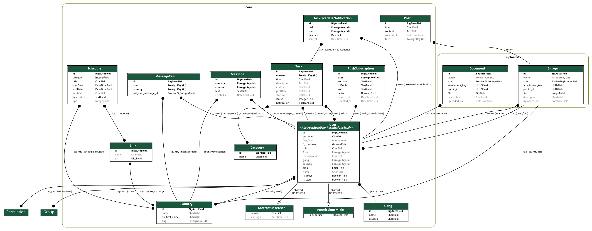

# Modelo de dados atual

Diagrama gerado em **27/11/2026** diretamente dos modelos Django das aplicações `core` e `uploader` do backend. Representa a estrutura declarada no código; não é uma inspeção do banco publicado nem comprova que suas migrações estejam aplicadas.

[](modelo-de-dados.png)

[Fonte DOT gerada pelo Django](modelo-de-dados.dot).

## Entidades e relações

| Entidade | Papel e relações principais |
| --- | --- |
| User | Conta individual; papel student/evaluator/organizer, turma Gang, país Country e foto Image. Flags de administração são independentes do papel. |
| Country / Gang | Delegação/país e turma escolar. Cada aluno tem no máximo um país; ausência de país indica espera de atribuição. |
| Task / Category | Tarefa com criador, status, datas, categorias e vários responsáveis User. Não há entidade de nota. |
| Schedule | Atividade do cronograma com vários países e links; categoria e tipo são escolhas do modelo. |
| Link | Nome/URL compartilhados com delegações e associados às atividades. |
| Post | Postagem com texto, data e imagem; não possui categoria. |
| Message / MessageRead | Mensagem por país e posição de leitura por usuário/país. last_read_message_id é um marcador numérico, não uma ForeignKey. |
| PushSubscription | Inscrição de navegador vinculada ao usuário. |
| TaskOverdueNotification | Registro único por tarefa, responsável e prazo para controlar avisos de atraso. |
| Image / Document | Arquivos, proprietário, tamanho e chaves de associação; Document não equivale a Link. |

O diagrama inclui referências à autenticação Django, mas não detalha todas as tabelas de infraestrutura, sessão ou allauth. Relações ManyToMany têm tabelas intermediárias criadas pelo ORM. As migrações versionadas do backend definem a evolução do schema.

## Atualizar o diagrama

No backend, com as dependências instaladas pelo PDM e Graphviz disponível:

```sh
pdm run diagram --settings=app.settings_test
pdm run python manage.py graph_models core uploader --disable-sort-fields -S -g --dot -o core.dot --settings=app.settings_test
```

O primeiro comando gera `core.png` conforme o script de `pyproject.toml`. Copiar `core.png` para `SINUCA-Documentacao-PI/docs/modelo-de-dados.png` e `core.dot` para `docs/modelo-de-dados.dot`. Atualizar a data, revisar as relações e versionar os dois arquivos juntos. A configuração isolada evita carregar `.env` e usa banco em memória; gerar o diagrama não requer importar ou substituir dados reais.

## Modelagem futura

Ainda não existem entidades de avaliação, nota, tema/modalidade avaliativa ou verificação institucional de matrícula. Definir com Edvanderson as regras antes de criá-las. Se houver edição anual do evento, prever sua relação com delegações e avaliações e a preservação do histórico. Categorias de tarefa e tipos de cronograma não são automaticamente modalidades de avaliação.
